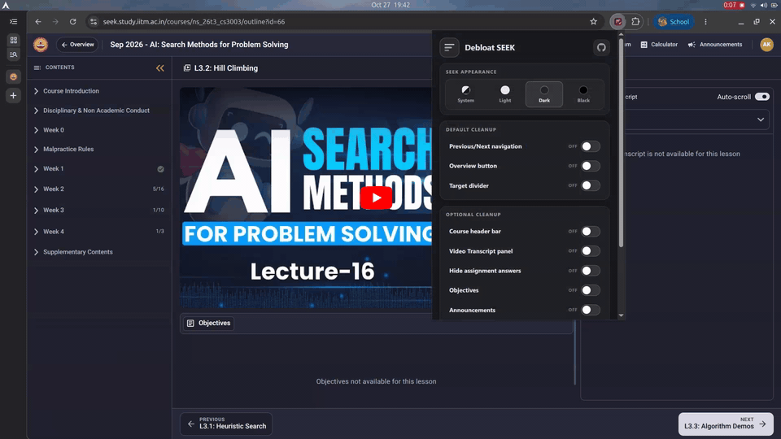
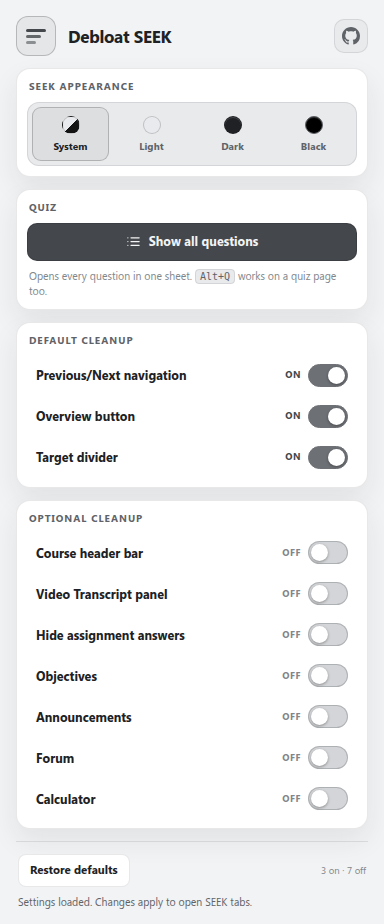

# Debloat SEEK

Declutter and customize the IITM BS Degree SEEK Portal.

[Download latest release](https://github.com/aloktripathi1/debloat-seek/releases/latest) · [Contributing](CONTRIBUTING.md) · [MIT License](LICENSE)

Current version: **1.2.11**.

**Unofficial, beta, not affiliated with IIT Madras.** Debloat SEEK is a free, local-only Chrome extension that hides clutter, cleans up the course overview and assessment pages, adds themes, and can hide assignment answers for practice.

It does not call SEEK APIs, send data anywhere, or change course content, submissions, scores, or the lesson/video player.

## Demo

<p align="center">
  
</p>

The demo switches to the Black theme, then hides Previous/Next, Overview, the target divider, the course header, and the video transcript one by one.

## Features

### Default cleanup

- Hide the Previous/Next unit navigation
- Hide the Overview button
- Hide the target divider

### Optional cleanup

- Hide the course header bar
- Hide the video transcript panel
- Hide assignment answers, expected answers, verdict headers, feedback, and correctness colours in reviewed assignments
- Hide the Objectives tab and panel while keeping other lesson tabs usable
- Hide announcements
- Hide the Forum button
- Hide the Calculator button

### Interface

- **System**, **Light**, **Dark**, and **Black** themes
- Cleaner course overview and assessment layouts
- The lesson/video player, tabs, objectives, transcript, and course bar keep SEEK's original layout and behaviour
- Settings sync through `chrome.storage.sync` and apply automatically when SEEK opens

## Popup



## Install

Not on the Chrome Web Store yet. Install it manually:

1. Download the ZIP from the latest release using the link above, or open the [GitHub repository](https://github.com/aloktripathi1/debloat-seek), click **Code**, then **Download ZIP**.
2. Extract the ZIP. On Windows, right-click it and choose **Extract All**. On macOS, double-click it.
3. Open `chrome://extensions`.
4. Turn on **Developer mode** in the top-right corner.
5. Click **Load unpacked**.
6. Select the extracted folder that contains `manifest.json`.
7. Pin **Debloat SEEK** from the Chrome extensions menu, open SEEK, and reload the tab.

Works in Chrome and other Chromium browsers such as Edge and Brave. **It is not a Firefox extension.**

## Usage

Click the Debloat SEEK icon in the toolbar.

- Default cleanups are already on.
- Optional cleanups are off until you switch them on.
- Changes apply to open SEEK tabs immediately.
- **Restore defaults** turns the default cleanups back on, the optional cleanups off, and the theme back to **System**.

## How it works

The content script sets state attributes on `<html>`, and `styles.css` hides or restyles matching SEEK elements. Elements are not deleted, and Angular can rerender the page without breaking the cleanup.

Everything is local. There is no remote code, analytics, or SEEK API access. Turning an option off removes its CSS rule and restores SEEK's original styling.

## Development

There is no build step. Load the repository folder directly with **Load unpacked**.

Run the checks from the repository root:

```bash
python3 tests/static-check.py
python3 tests/selector-check.py
python3 tests/e2e_extension.py
```

The browser test uses Playwright with Chrome for Testing. See the top of `tests/e2e_extension.py` for the one-time browser install command.

## Contributing

Issues and pull requests are welcome. See [CONTRIBUTING.md](CONTRIBUTING.md) for setup, tests, and contribution guidelines.

Please keep private SEEK snapshots and personal data out of the public repository. Use the gitignored `local/` folder for those files.

## Troubleshooting

- **The icon is missing:** click the puzzle-piece icon in Chrome's toolbar and pin **Debloat SEEK**.
- **Changes are not showing:** reload the SEEK tab after installing or updating the extension.
- **An option stopped working:** SEEK may have changed its page structure. Turn the option off, reload, and open an issue with details.
- **You want a clean reset:** click **Restore defaults** in the popup, or remove the extension from `chrome://extensions`.

## Known limitations

- The extension only runs on `https://seek.study.iitm.ac.in/*` and `https://seek.onlinedegree.iitm.ac.in/*`.
- It is designed for Chromium browsers, not Firefox.
- SEEK can change its page structure at any time, so selectors may need updates.
- Changes are visual and local. The extension does not modify SEEK data or submissions.

## Disclaimer

- This extension is not affiliated with IIT Madras. “IITM” is used only to describe the portal it supports.
- SEEK updates may temporarily affect some features. The extension aims to keep the portal clean and customizable as it evolves.

## License

MIT. See [LICENSE](LICENSE).
